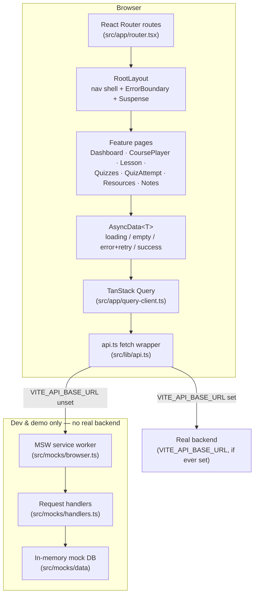

# LMS Student Learning & Assessment Portal

A student-facing learning management portal built with React, TypeScript, and Vite. Students can work through
courses and lessons, attempt quizzes with instant grading, track their progress, keep personal notes, and
download course resources.

**Live demo:** _add your deployed URL here after connecting the repo to Vercel_

## Features

- **Dashboard** — an at-a-glance view of enrolled courses and progress.
- **Course player & lessons** — browse a course's lessons, mark lessons complete, and navigate between them.
- **Quizzes** — a dynamic, generic quiz-taking engine supporting nine question types (single/multiple choice,
  true/false, short/long text, numeric, matching, ordering, and fill-in-the-blank), with instant client-side
  scoring and a results view.
- **Notes** — full CRUD: create, edit, bookmark, and delete personal notes against a course.
- **Resources** — downloadable course resources with download-count tracking.
- **Resilient data loading** — every list/detail view uses a shared `AsyncData<T>` component with consistent
  loading, empty, and error (with retry) states, backed by page-level error boundaries so a crash in one page
  never takes down the navigation shell.

## Tech stack

| Concern              | Choice                                                              |
| -------------------- | -------------------------------------------------------------------- |
| UI framework          | React 19 + TypeScript (strict mode)                                  |
| Build tool            | Vite                                                                  |
| Routing               | React Router 7, with route-level code-splitting via `React.lazy`     |
| Server state          | TanStack Query                                                       |
| Styling               | Tailwind CSS v4 (design tokens in `src/styles/globals.css`)          |
| Components            | shadcn-style components on Base UI                                   |
| Mock API              | Mock Service Worker (MSW) — see [Mock API](#mock-api-no-real-backend) |
| Error handling        | `react-error-boundary` + TanStack Query's `QueryErrorResetBoundary`   |
| Testing               | Vitest + React Testing Library + MSW (`msw/node`)                    |
| Linting               | ESLint 9 (flat config) + `typescript-eslint` + `eslint-plugin-jsx-a11y` |
| Performance auditing  | Lighthouse                                                            |

## Architecture



Each feature folder under `src/features/<name>/` owns its own `api.ts` (built on the generic
`useApiQuery<T>` hook), `pages/`, and `components/`. Nothing outside `src/lib/api.ts` knows whether a request
is hitting a real server or MSW — that's decided in one place by whether `VITE_API_BASE_URL` is set.

### Folder structure

```
src/
  app/            App shell, router, TanStack Query client
  components/
    layout/       RootLayout (nav + error boundary + suspense), MobileNav
    ui/           Shared UI primitives, including AsyncData<T>
    error-boundary/
  features/
    course-player/
    dashboard/
    notes/
    progress/
    quizzes/
    resources/
  lib/            api.ts fetch wrapper
  mocks/          MSW handlers + in-memory mock data (dev/demo API)
  test/           Vitest setup + test utilities
  styles/         Design tokens (globals.css)
  types/          Shared domain types
```

## Mock API (no real backend)

This project has no real backend yet — every request is answered by MSW. `src/main.tsx` enables the MSW
service worker whenever `VITE_API_BASE_URL` is **not** set, which is true in development and in this
project's current production deployment too (so the live demo actually shows working data instead of error
states). If a real backend is ever built, setting `VITE_API_BASE_URL` turns mocking off automatically —
nothing in the feature code needs to change.

## Getting started

```bash
npm install
npm run dev          # start the dev server (http://localhost:5173)
```

### Building & previewing a production bundle

```bash
npm run build         # type-checks (tsc -b) then builds to dist/
npm run preview        # serve the production build (http://localhost:4173)
```

### Testing

```bash
npm run test           # run the Vitest suite once
npm run test:watch     # run it in watch mode
npm run coverage       # run the suite and generate a coverage report (coverage/index.html)
```

### Linting & type-checking

```bash
npm run lint
npx tsc --noEmit
```

### Auditing performance & accessibility

Run against the **production build**, not the dev server, for a representative score:

```bash
npm run build
npm run preview
npx lighthouse http://localhost:4173 --preset=desktop --view
```

## Deployment

The app is a static Vite SPA, deployed to Vercel. `vercel.json` rewrites every path to `index.html` so
client-side routes (e.g. `/quizzes/1`) work correctly on refresh and direct navigation. Pushing to the
repository's main branch triggers an automatic build and deploy.

## Project log

Built sprint by sprint; see `claude/brief.md` (or ask in-session) for the detailed log of what shipped in
each sprint, including test/coverage/Lighthouse evidence for the testing & accessibility sprint.
